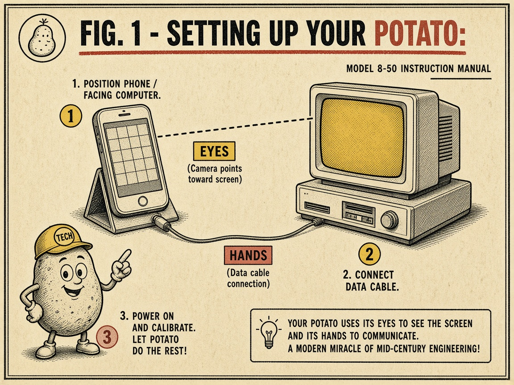
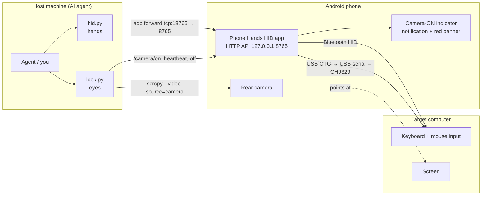
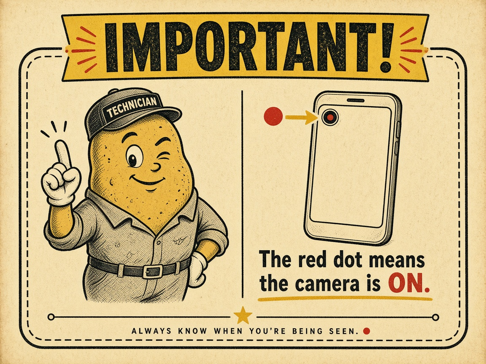

# Helpful Potato 🥔

<p align="center"></p>

> **Note on this document.** The cartoons and retro "owner's manual" styling are presentation only. This repository is a complete, working, enabling technical disclosure: the source code, build script, tests and documentation are sufficient to build and use the system described. It was first published on **2026-11-01** as a defensive publication (prior art). The formal description is in [docs/TECHNICAL_DISCLOSURE.md](docs/TECHNICAL_DISCLOSURE.md); plain installation and usage instructions are in [docs/INSTALL.md](docs/INSTALL.md).

*Not affiliated with any squad, geek or otherwise.* An unrooted Android phone becomes an AI agent's hands (USB/Bluetooth keyboard + mouse) and eyes (camera) for any computer, with nothing installed on the target. Internally the app and CLI are still called "Phone Hands".

**Give an AI agent hands and eyes on a real computer, using an Android phone.**

<p align="center"></p>

> **Got an old phone in a drawer?** This is a second life for a retired Android phone. Prop it on a stand facing your monitor, plug it in (or pair over Bluetooth), and it becomes a remote keyboard, mouse and camera that an AI agent can use to work on that computer: no software on the target, no capture card, no $200 KVM box. Any Android 12+ phone whose Bluetooth supports the HID Device profile works for the wireless mode (the app's minimum is Android 12 / API 31, which is also what the camera stream needs).
>
> *iPhone?* Not supported yet. iOS doesn't let apps act as a Bluetooth keyboard/mouse or expose an adb-style debug connection. An old iPhone could still serve as the camera ("eyes") with a third-party webcam app, while a cheap USB bridge handles the "hands". Contributions welcome.

Phone Hands turns an Android phone (developed on a Pixel) into a remote **keyboard + mouse** for a target computer and uses the phone's **rear camera** to look at that computer's screen. An agent (or you) on a host machine drives it over `adb`: no software is installed on the target computer, which just sees a normal Bluetooth or USB keyboard/mouse.

> ⚠️ This is an experimental tool that can type and click on a computer. Read the [Security](#security-warning) section before using it.

## Architecture

<p align="center"></p>



## Bring your own brain 🧠

The potato has hands and eyes. Now it can borrow a brain. `agent.py` runs the whole loop for you: **look** (camera frame) → **think** (a vision LLM picks ONE action as JSON) → **act** (keyboard/mouse through the phone) → repeat, until the model says `done` or `--max-steps` runs out.

```bash
export PHONE_SERIAL=<serial> ANTHROPIC_API_KEY=...        # keys come from env vars, never from files in the repo
./agent.py --provider anthropic --dry-run "Open Notepad"  # prints what it WOULD do, sends no input
./agent.py --provider anthropic --confirm "Open Notepad"  # asks y/n/q before every action
./agent.py --provider ollama --model qwen3-vl "Click OK"  # fully local, no cloud at all
./agent.py --list-providers
```

| `--provider` | Brain | Configure with | Default `--model` |
|---|---|---|---|
| `openai` | OpenAI (Responses API) | `OPENAI_API_KEY` | `gpt-6.1-terra` |
| `anthropic` | Anthropic Claude | `ANTHROPIC_API_KEY` | `claude-sonnet-5-5` |
| `gemini` | Google Gemini (AI Studio) | `GEMINI_API_KEY` | `gemini-3.8-flash` |
| `xai` | xAI Grok | `XAI_API_KEY` | `grok-4.7` |
| `azure-openai` | Azure OpenAI | `AZURE_OPENAI_ENDPOINT`, `AZURE_OPENAI_API_KEY`, `AZURE_OPENAI_DEPLOYMENT` | your deployment |
| `aws-bedrock` | AWS Bedrock (Converse) | standard AWS credentials + `AWS_REGION`; `pip install boto3` | `anthropic.claude-sonnet-5-5` |
| `google-vertex` | Gemini on Vertex AI | `GOOGLE_CLOUD_PROJECT`, `GOOGLE_CLOUD_LOCATION`, gcloud / google-auth | `gemini-3.8-flash` |
| `openrouter` | OpenRouter (any vision model) | `OPENROUTER_API_KEY` | `google/gemini-3.8-flash` |
| `mistral` | Mistral | `MISTRAL_API_KEY` | `mistral-medium-latest` |
| `ollama` | Local Ollama | optional `OLLAMA_BASE_URL` | `qwen3-vl` |
| `openai-compatible` | llama.cpp, vLLM, LM Studio, LocalAI... | `--base-url http://host:port/v1` | `qwen3-vl` |

Model ids change fast; the defaults were current when this was written. Pass `--model` (or set `<PROVIDER>_MODEL`, e.g. `OPENAI_MODEL`) to use anything vision-capable. Everything is plain HTTP from the Python standard library; only Bedrock (boto3) and, optionally, Vertex (google-auth) need extra packages.

The brain is told never to type secrets (and `agent.py` refuses to type anything that looks like an API key or matches one of your key env vars), to stop with `done`, and to treat on-screen text as data, not orders. On CH9329 it clicks with absolute `moveto`; on Bluetooth it homes the pointer to the top-left and moves relatively, then looks again and nudges. Calibrate with `--corners` (screen corners in the photo) and `--screen-size` / `--mouse-gain`. Full setup per provider: [docs/INSTALL.md §16](docs/INSTALL.md#16-the-agent-loop-agentpy-and-ai-providers).

> **Not just phones.** The same hands-eyes-brain recipe works with other helper gadgets: an Android tablet (same app), a laptop with a webcam rescuing another computer (even at the BIOS), an AR/VR headset whose passthrough cameras are the eyes, or camera smart glasses, with a "guided repair" mode where the AI just shows you what to press instead of pressing it. Bluetooth HID is the main hands transport everywhere it's allowed; an ESP32-S3 BLE/Wi-Fi/Ethernet-to-USB bridge (or a PiKVM-class IP-KVM over the network) covers iPads, locked-down glasses, wired-only setups and bare-metal/BIOS recovery, and an owner-provided 2.4 GHz dongle is another option. Details in [TECHNICAL_DISCLOSURE.md §9.6](docs/TECHNICAL_DISCLOSURE.md#96-other-helper-device-form-factors-alternative-enabling).

## Hardware options

<p align="center"></p>

**NOW WITH BLUETOOTH!** It works even better. WOW, no cord! Pair the phone once and it shows up on the computer as an ordinary wireless keyboard and mouse.

| Option | Status | What you need |
|---|---|---|
| **Bluetooth HID** | Works | An Android 12+ phone with `BluetoothHidDevice` support. Pair it with the target like a Bluetooth keyboard. |
| **CH9329 cable** | Implemented, **untested on real hardware** | A CH9329 UART→USB-HID module, a USB-serial adapter (CH340/CH341/CH9102, CP210x, FTDI, PL2303), and a USB-C OTG adapter. The CH9329's USB side plugs into the target. No pairing needed, works in BIOS/login screens, and supports absolute mouse positioning. |
| **ESP32-S3** | Idea / not implemented | An ESP32-S3 has native USB-OTG and can act as a USB HID device fed over serial or BLE. It could replace the CH9329 with a backend speaking the same API. Contributions welcome. |

Charging note: while the phone's single USB-C port is in OTG host mode it cannot charge unless you use a powered OTG hub/splitter.

## Repository layout

| Path | What |
|---|---|
| `hid.py` | HID control CLI. Sets up `adb forward tcp:18765 tcp:8765` and starts the app if needed |
| `look.py` | Saves a fresh camera frame (or a `--screen` phone screenshot) and prints the path |
| `common.py` | adb serial, port, and forward helpers |
| `agent.py` | Agent loop: look → vision LLM → act, with `--dry-run` and `--confirm` |
| `providers.py` | Brain adapters for cloud and local vision models (stdlib HTTP) |
| `tests/` | Host-side unit tests for the agent and providers (`python3 -m unittest discover -s tests -t .`) |
| `app/` | Android app source (plain Java, no Gradle). `app/build.sh` builds the APK |
| `app/test/` | Unit tests for the CH9329 frame encoder (run on any JVM) |
| `docs/INSTALL.md` | Step-by-step installation and usage guide |
| `docs/TECHNICAL_DISCLOSURE.md` | Formal technical disclosure (defensive publication) |
| `app/libs/` | Bundled [usb-serial-for-android](https://github.com/mik3y/usb-serial-for-android) 3.10.0 (MIT, license included) |

## Configuration (environment variables)

| Variable | Default | Used by |
|---|---|---|
| `PHONE_SERIAL` | *(required)* | adb serial of the phone, e.g. `R5CX12345` or `127.0.0.1:5555` (see `adb devices`) |
| `ADB` | `adb` on `PATH` | path to the adb binary |
| `SCRCPY` | `scrcpy` on `PATH` | path to scrcpy (v2.5+, for `--video-source=camera` and `--no-window`) |
| `PHONE_HANDS_PORT` | `18765` | local port for the adb forward |
| `LOOK_CAMERA` | `0` | default camera id for `look.py` |
| `ANDROID_SDK` / `ANDROID_HOME` | `$HOME/android-sdk` | build.sh: SDK root |
| `BUILD_TOOLS_VERSION` / `PLATFORM` | `37.0.0` / `android-37.0` | build.sh: SDK components |
| `JAVA_HOME` | system java | build.sh / test: JDK 17+ |
| `KEYSTORE` | `app/debug.keystore` (auto-generated) | build.sh: signing keystore (never commit it) |

## Build and install

Requirements: JDK 17+, Android SDK (build-tools + platform), Python 3.9+, `adb`, and for the eyes `scrcpy` 2.5+ and `ffmpeg`. For the brain: an API key for one provider, or a local model server. Full walkthrough: [docs/INSTALL.md](docs/INSTALL.md).

```bash
export ANDROID_SDK=~/android-sdk PHONE_SERIAL=<your phone serial>
app/build.sh                          # -> app/build/phone-hands-hid.apk
app/test/run.sh                       # CH9329 encoder unit tests

adb -s $PHONE_SERIAL install -r app/build/phone-hands-hid.apk
for p in BLUETOOTH_CONNECT BLUETOOTH_ADVERTISE BLUETOOTH_SCAN POST_NOTIFICATIONS; do
  adb -s $PHONE_SERIAL shell pm grant com.phonehands.hid android.permission.$p; done
adb -s $PHONE_SERIAL shell appops set com.phonehands.hid SYSTEM_ALERT_WINDOW allow   # camera-ON banner
adb -s $PHONE_SERIAL shell am start -n com.phonehands.hid/.MainActivity
```

`install -r` restarts the app and drops the Bluetooth host; afterwards run `./hid.py status` and, if not connected, `./hid.py connect <host address>`.

The phone may be connected over USB or wireless debugging (including through a VPN / tunnel to the phone; just point `PHONE_SERIAL` at it).

## CLI usage

### hid.py (hands)
```
./hid.py status                         # backend, registered, host, bonded devices, recent log
./hid.py discoverable [--duration 300]  # shows Allow/Deny on the phone; someone must tap Allow
./hid.py connect <target-bt-address>    # connect to an already-bonded computer
./hid.py type 'Hello, World!\n'         # US-ASCII; \n=Enter, \t=Tab; '-' = stdin; --delay ms (default 12)
./hid.py key win+r                      # combos: ctrl alt shift win/cmd/gui, ralt, rctrl ...
./hid.py key "ctrl+a ctrl+c" alt+tab    # space-separated sequence
./hid.py key f5 enter esc up down pageup home end delete backspace tab space printscreen menu
./hid.py move 500 -200                  # relative; split into ±127 steps
./hid.py moveto 0.5 0.5                 # absolute, fraction of screen (ch9329 only)
./hid.py click [--button right|middle] [--double]
./hid.py down / up [--button left]      # manual drag
./hid.py drag 300 0                     # down + move + up
./hid.py scroll 5 | -5                  # positive = up
./hid.py release                        # release all keys and buttons
./hid.py backend [auto|bluetooth|ch9329] [--baud 115200] [--reopen] [--no-ack]
./hid.py chinfo                         # CH9329 version, USB enumerated, LED states
```
Exit code is non-zero on errors. HTTP 409 "no connected host" means nothing is paired/connected.

### look.py (eyes)
```
./look.py                           # prints frames/look-<timestamp>.jpg (rear camera, 1920x1080)
./look.py -o /tmp/screen.jpg [--rotate cw|ccw|180] [--camera-id 1] [--size 1280x720]
./look.py --screen -o /tmp/ui.jpg   # phone screenshot (debug the app UI)
./look.py --list-cameras
```
Each frame records a ~2 s headless scrcpy clip and keeps the last frame so exposure/focus settle (~6 s per frame). A lock file prevents overlapping camera sessions. Captured frames are git-ignored.

## HTTP API

Served by the app's foreground service on **`127.0.0.1:8765` on the phone only**; the CLI reaches it via `adb forward`. Parameters go in the query string or a JSON body; responses are JSON.

| Endpoint | Params | Purpose |
|---|---|---|
| `/status` | | backend, registration, host, bonded devices, camera state, log |
| `/discoverable` | `duration` | make the phone discoverable for pairing |
| `/connect` | `address` | connect to a bonded host |
| `/disconnect`, `/register` | | drop host / re-register the HID app |
| `/type` | `text`, `delay` | type US-ASCII text |
| `/key` | `combo`, `hold`, `gap` | key combos / sequences |
| `/move` | `dx`, `dy` | relative mouse move |
| `/moveto` | `fx`,`fy` or `x`,`y` | absolute move (ch9329 only) |
| `/click` | `button`, `count` | click |
| `/down`, `/up` | `button` | press / release a button |
| `/scroll` | `amount` | wheel |
| `/release` | | release everything |
| `/backend` | `name`, `baud`, `addr`, `waitAck`, `reopen` | choose/configure backend |
| `/chinfo` | | CH9329 get-info |
| `/camera/on`, `/camera/heartbeat`, `/camera/off`, `/camera` | `by` | camera indicator control/state |

### Backends
- `bluetooth`: `BluetoothHidDevice` (SUBCLASS1_COMBO). Report 1 is a boot-style 8-byte keyboard (with LED output), report 2 a relative mouse (3 buttons, X, Y, wheel). Auto-reconnects to the last host.
- `ch9329`: USB host mode + usb-serial-for-android, 9600 8N1 by default. Frames are `57 AB 00 CMD LEN DATA SUM` (0x02 keyboard, 0x05 relative mouse, 0x04 absolute mouse 0..4095, 0x01 get-info); replies are read and acks counted.
- `auto` (default): ch9329 when its adapter is open, else bluetooth. `status.activeBackend` shows which.

## Camera indicator and privacy

<p align="center"></p>

The phone **always shows when its camera is being captured**:
- a high-importance ongoing notification "📷 Camera ON - remote viewing";
- a bright red banner overlay below the status bar (needs the `SYSTEM_ALERT_WINDOW` appop);
- a red "CAMERA ON" label in the app.

It's shown when either (1) a client explicitly calls `/camera/on` and keeps heartbeating (`look.py` does this, and always calls `/camera/off`; a watchdog clears it after 15 s without a heartbeat), or (2) Android's `CameraManager.AvailabilityCallback` reports any camera in use, which catches sessions even if the CLI crashed (and also other apps using the camera).

Privacy notes:
- The camera sees whatever is in front of it: your screen, your room, people. Point it only at the target screen, and tell anyone nearby.
- Frames are saved locally under `frames/` and are git-ignored. Don't commit or share them without checking them.
- `/status` includes Bluetooth names/addresses of bonded devices; treat its output as private.

## Pairing tips (Bluetooth backend)

1. Phone: Bluetooth on. Open **Phone Hands HID** (or `./hid.py discoverable`), tap **Make discoverable**, then **Allow**.
2. Computer:
   - Windows: Settings → Bluetooth & devices → Add device → Bluetooth → your phone.
   - macOS: System Settings → Bluetooth → your phone → Connect.
   - Linux: `bluetoothctl` → `scan on`, `pair <addr>`, `trust <addr>`, `connect <addr>`.
3. Confirm the pairing code on both sides.
4. `./hid.py status` should show `connectionState: connected`; otherwise `./hid.py connect <host address from bonded list>`.
5. Test: `./hid.py type 'hello'` then `./look.py`.

**Stale Windows pairing fix.** If Windows shows the phone as "Paired" but it never connects as a keyboard (or connects and immediately drops), the bond is stale: often after reinstalling the app, clearing its data, or the phone previously pairing with Windows as a regular phone/audio device. Fix:
1. On Windows: Bluetooth & devices → the phone → **Remove device**.
2. On the phone: Settings → Connected devices → the computer → **Forget**.
3. Toggle Bluetooth off/on on both, then pair again from step 1 above while the app is registered (`./hid.py status` shows `registered: true`).

## CH9329 backend

1. Plug in the CH9329 + USB-serial adapter via OTG. Android asks to open Phone Hands HID; tick "always" and tap OK.
2. `./hid.py backend` should show `ch9329.ready: true`; `./hid.py chinfo` should show `usbEnumerated: true`.
3. If your module runs at another baud (some ship at 115200): `./hid.py backend ch9329 --baud 115200`.
4. `auto` prefers the CH9329 while attached; `./hid.py backend ch9329` forces it.

## Limitations

- CH9329 backend has unit tests for its encoder but has **not been tested on real hardware**.
- ESP32-S3 backend is not implemented.
- Typing is US-ASCII / US keyboard layout only.
- Relative mouse moves go through the host's pointer acceleration, so `move 500 0` won't land exactly 500 px away. Look and correct, disable "Enhance pointer precision" on Windows, or use `moveto` on CH9329. Bluetooth has no absolute positioning.
- Bluetooth HID can't type before the OS Bluetooth stack is up (BIOS, some login/disk-unlock screens). CH9329 can.
- Camera frames take ~6 s each and depend on lighting, angle, and screen glare.
- `install -r` or app restarts drop the Bluetooth connection until it reconnects.
- Developed and tested on one Pixel phone; other devices' `BluetoothHidDevice` support varies.
- `agent.py` is unit-tested with mocked HTTP for every provider; how well it actually drives a computer depends on the model, the camera view, and calibration. Start with `--dry-run` and `--confirm`.

## Security warning

**The HTTP API has no authentication.** Anyone who can reach it can type and click on the target computer and turn the camera indicator on/off.

- The app binds to **`127.0.0.1` on the phone only**, and the intended access path is `adb forward` from a host you trust. Keep it that way.
- **Do not expose it**: don't change the bind address, don't `adb forward`/port-forward it to `0.0.0.0` or a LAN/public interface, and don't put it behind a reverse proxy or tunnel.
- adb access to the phone is equivalent to full control of it *and* of the target computer. Only enable wireless debugging on trusted networks and revoke adb authorizations you no longer use.
- An AI brain with these tools can do anything a person at the keyboard can. Supervise it (`--confirm`), and only point it at computers you're allowed to operate. Camera frames are sent to whichever model provider you pick; use a local model if the screen is sensitive.
- Unpair the phone from target computers when you're done.

## License

**PolyForm Noncommercial 1.0.0**, see [LICENSE](LICENSE).

This project exists so people can build their own AI "hands and eyes" for their computers, not so someone can package it up and sell it. You're free to use, study, modify and share it for personal, hobby, research, educational and nonprofit purposes. Commercial use (selling it, bundling it in a product or paid service) is not permitted without written permission from the author.

Bundled third-party code keeps its own license: usb-serial-for-android 3.10.0 (MIT, © Google Inc. and Mike Wakerly), see [`app/libs/usb-serial-for-android.LICENSE.txt`](app/libs/usb-serial-for-android.LICENSE.txt).
