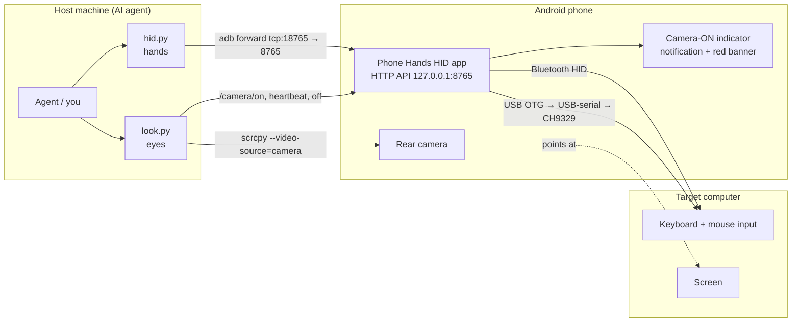

# Phone Hands

**Give an AI agent hands and eyes on a real computer, using an Android phone.**

Phone Hands turns an Android phone (developed on a Pixel) into a remote **keyboard + mouse** for a target computer and uses the phone's **rear camera** to look at that computer's screen. An agent (or you) on a host machine drives it over `adb`: no software is installed on the target computer, which just sees a normal Bluetooth or USB keyboard/mouse.

> ⚠️ This is an experimental tool that can type and click on a computer. Read the [Security](#security-warning) section before using it.

## Architecture



## Hardware options

| Option | Status | What you need |
|---|---|---|
| **Bluetooth HID** | Works | An Android 9+ phone with `BluetoothHidDevice` support. Pair it with the target like a Bluetooth keyboard. |
| **CH9329 cable** | Implemented, **untested on real hardware** | A CH9329 UART→USB-HID module, a USB-serial adapter (CH340/CH341/CH9102, CP210x, FTDI, PL2303), and a USB-C OTG adapter. The CH9329's USB side plugs into the target. No pairing needed, works in BIOS/login screens, and supports absolute mouse positioning. |
| **ESP32-S3** | Idea / not implemented | An ESP32-S3 has native USB-OTG and can act as a USB HID device fed over serial or BLE. It could replace the CH9329 with a backend speaking the same API. Contributions welcome. |

Charging note: while the phone's single USB-C port is in OTG host mode it cannot charge unless you use a powered OTG hub/splitter.

## Repository layout

| Path | What |
|---|---|
| `hid.py` | HID control CLI. Sets up `adb forward tcp:18765 tcp:8765` and starts the app if needed |
| `look.py` | Saves a fresh camera frame (or a `--screen` phone screenshot) and prints the path |
| `common.py` | adb serial, port, and forward helpers |
| `app/` | Android app source (plain Java, no Gradle). `app/build.sh` builds the APK |
| `app/test/` | Unit tests for the CH9329 frame encoder (run on any JVM) |
| `app/libs/` | Bundled [usb-serial-for-android](https://github.com/mik3y/usb-serial-for-android) 3.10.0 (MIT, license included) |

## Configuration (environment variables)

| Variable | Default | Used by |
|---|---|---|
| `PHONE_SERIAL` | *(required)* | adb serial of the phone, e.g. `R5CX12345` or `127.0.0.1:5555` (see `adb devices`) |
| `ADB` | `adb` on `PATH` | path to the adb binary |
| `SCRCPY` | `scrcpy` on `PATH` | path to scrcpy (v2.0+, for `--video-source=camera`) |
| `PHONE_HANDS_PORT` | `18765` | local port for the adb forward |
| `ANDROID_SDK` / `ANDROID_HOME` | `$HOME/android-sdk` | build.sh: SDK root |
| `BUILD_TOOLS_VERSION` / `PLATFORM` | `37.0.0` / `android-37.0` | build.sh: SDK components |
| `JAVA_HOME` | system java | build.sh / test: JDK 17+ |
| `KEYSTORE` | `app/debug.keystore` (auto-generated) | build.sh: signing keystore (never commit it) |

## Build and install

Requirements: JDK 17+, Android SDK (build-tools + platform), Python 3, `adb`, and for the eyes `scrcpy` and `ffmpeg`.

```bash
export ANDROID_SDK=~/android-sdk PHONE_SERIAL=<your phone serial>
app/build.sh                          # -> app/build/phone-hands-hid.apk
app/test/run.sh                       # CH9329 encoder unit tests

adb -s $PHONE_SERIAL install -r app/build/phone-hands-hid.apk
for p in BLUETOOTH_CONNECT BLUETOOTH_ADVERTISE BLUETOOTH_SCAN POST_NOTIFICATIONS; do
  adb -s $PHONE_SERIAL shell pm grant com.phonehands.hid android.permission.$p; done
adb -s $PHONE_SERIAL shell appops set com.phonehands.hid SYSTEM_ALERT_WINDOW allow   # camera-ON banner
adb -s $PHONE_SERIAL shell am start -n com.phonehands.hid/.MainActivity
```

`install -r` restarts the app and drops the Bluetooth host; afterwards run `./hid.py status` and, if not connected, `./hid.py connect <host address>`.

The phone may be connected over USB or wireless debugging (including through a VPN / tunnel to the phone; just point `PHONE_SERIAL` at it).

## CLI usage

### hid.py (hands)
```
./hid.py status                         # backend, registered, host, bonded devices, recent log
./hid.py discoverable [--duration 300]  # shows Allow/Deny on the phone; someone must tap Allow
./hid.py connect AA:BB:CC:DD:EE:FF      # connect to an already-bonded computer
./hid.py type 'Hello, World!\n'         # US-ASCII; \n=Enter, \t=Tab; '-' = stdin; --delay ms (default 12)
./hid.py key win+r                      # combos: ctrl alt shift win/cmd/gui, ralt, rctrl ...
./hid.py key "ctrl+a ctrl+c" alt+tab    # space-separated sequence
./hid.py key f5 enter esc up down pageup home end delete backspace tab space printscreen menu
./hid.py move 500 -200                  # relative; split into ±127 steps
./hid.py moveto 0.5 0.5                 # absolute, fraction of screen (ch9329 only)
./hid.py click [--button right|middle] [--double]
./hid.py down / up [--button left]      # manual drag
./hid.py drag 300 0                     # down + move + up
./hid.py scroll 5 | -5                  # positive = up
./hid.py release                        # release all keys and buttons
./hid.py backend [auto|bluetooth|ch9329] [--baud 115200] [--reopen] [--no-ack]
./hid.py chinfo                         # CH9329 version, USB enumerated, LED states
```
Exit code is non-zero on errors. HTTP 409 "no connected host" means nothing is paired/connected.

### look.py (eyes)
```
./look.py                           # prints frames/look-<timestamp>.jpg (rear camera, 1920x1080)
./look.py -o /tmp/screen.jpg [--rotate cw|ccw|180] [--camera-id 1] [--size 1280x720]
./look.py --screen -o /tmp/ui.jpg   # phone screenshot (debug the app UI)
./look.py --list-cameras
```
Each frame records a ~2 s headless scrcpy clip and keeps the last frame so exposure/focus settle (~6 s per frame). A lock file prevents overlapping camera sessions. Captured frames are git-ignored.

## HTTP API

Served by the app's foreground service on **`127.0.0.1:8765` on the phone only**; the CLI reaches it via `adb forward`. Parameters go in the query string or a JSON body; responses are JSON.

| Endpoint | Params | Purpose |
|---|---|---|
| `/status` | | backend, registration, host, bonded devices, camera state, log |
| `/discoverable` | `duration` | make the phone discoverable for pairing |
| `/connect` | `address` | connect to a bonded host |
| `/disconnect`, `/register` | | drop host / re-register the HID app |
| `/type` | `text`, `delay` | type US-ASCII text |
| `/key` | `combo`, `hold`, `gap` | key combos / sequences |
| `/move` | `dx`, `dy` | relative mouse move |
| `/moveto` | `fx`,`fy` or `x`,`y` | absolute move (ch9329 only) |
| `/click` | `button`, `count` | click |
| `/down`, `/up` | `button` | press / release a button |
| `/scroll` | `amount` | wheel |
| `/release` | | release everything |
| `/backend` | `name`, `baud`, `addr`, `waitAck`, `reopen` | choose/configure backend |
| `/chinfo` | | CH9329 get-info |
| `/camera/on`, `/camera/heartbeat`, `/camera/off`, `/camera` | `by` | camera indicator control/state |

### Backends
- `bluetooth`: `BluetoothHidDevice` (SUBCLASS1_COMBO). Report 1 is a boot-style 8-byte keyboard (with LED output), report 2 a relative mouse (3 buttons, X, Y, wheel). Auto-reconnects to the last host.
- `ch9329`: USB host mode + usb-serial-for-android, 9600 8N1 by default. Frames are `57 AB 00 CMD LEN DATA SUM` (0x02 keyboard, 0x05 relative mouse, 0x04 absolute mouse 0..4095, 0x01 get-info); replies are read and acks counted.
- `auto` (default): ch9329 when its adapter is open, else bluetooth. `status.activeBackend` shows which.

## Camera indicator and privacy

The phone **always shows when its camera is being captured**:
- a high-importance ongoing notification "📷 Camera ON - remote viewing";
- a bright red banner overlay below the status bar (needs the `SYSTEM_ALERT_WINDOW` appop);
- a red "CAMERA ON" label in the app.

It's shown when either (1) a client explicitly calls `/camera/on` and keeps heartbeating (`look.py` does this, and always calls `/camera/off`; a watchdog clears it after 15 s without a heartbeat), or (2) Android's `CameraManager.AvailabilityCallback` reports any camera in use, which catches sessions even if the CLI crashed (and also other apps using the camera).

Privacy notes:
- The camera sees whatever is in front of it: your screen, your room, people. Point it only at the target screen, and tell anyone nearby.
- Frames are saved locally under `frames/` and are git-ignored. Don't commit or share them without checking them.
- `/status` includes Bluetooth names/addresses of bonded devices; treat its output as private.

## Pairing tips (Bluetooth backend)

1. Phone: Bluetooth on. Open **Phone Hands HID** (or `./hid.py discoverable`), tap **Make discoverable**, then **Allow**.
2. Computer:
   - Windows: Settings → Bluetooth & devices → Add device → Bluetooth → your phone.
   - macOS: System Settings → Bluetooth → your phone → Connect.
   - Linux: `bluetoothctl` → `scan on`, `pair <addr>`, `trust <addr>`, `connect <addr>`.
3. Confirm the pairing code on both sides.
4. `./hid.py status` should show `connectionState: connected`; otherwise `./hid.py connect <host address from bonded list>`.
5. Test: `./hid.py type 'hello'` then `./look.py`.

**Stale Windows pairing fix.** If Windows shows the phone as "Paired" but it never connects as a keyboard (or connects and immediately drops), the bond is stale: often after reinstalling the app, clearing its data, or the phone previously pairing with Windows as a regular phone/audio device. Fix:
1. On Windows: Bluetooth & devices → the phone → **Remove device**.
2. On the phone: Settings → Connected devices → the computer → **Forget**.
3. Toggle Bluetooth off/on on both, then pair again from step 1 above while the app is registered (`./hid.py status` shows `registered: true`).

## CH9329 backend

1. Plug in the CH9329 + USB-serial adapter via OTG. Android asks to open Phone Hands HID; tick "always" and tap OK.
2. `./hid.py backend` should show `ch9329.ready: true`; `./hid.py chinfo` should show `usbEnumerated: true`.
3. If your module runs at another baud (some ship at 115200): `./hid.py backend ch9329 --baud 115200`.
4. `auto` prefers the CH9329 while attached; `./hid.py backend ch9329` forces it.

## Limitations

- CH9329 backend has unit tests for its encoder but has **not been tested on real hardware**.
- ESP32-S3 backend is not implemented.
- Typing is US-ASCII / US keyboard layout only.
- Relative mouse moves go through the host's pointer acceleration, so `move 500 0` won't land exactly 500 px away. Look and correct, disable "Enhance pointer precision" on Windows, or use `moveto` on CH9329. Bluetooth has no absolute positioning.
- Bluetooth HID can't type before the OS Bluetooth stack is up (BIOS, some login/disk-unlock screens). CH9329 can.
- Camera frames take ~6 s each and depend on lighting, angle, and screen glare.
- `install -r` or app restarts drop the Bluetooth connection until it reconnects.
- Developed and tested on one Pixel phone; other devices' `BluetoothHidDevice` support varies.

## Security warning

**The HTTP API has no authentication.** Anyone who can reach it can type and click on the target computer and turn the camera indicator on/off.

- The app binds to **`127.0.0.1` on the phone only**, and the intended access path is `adb forward` from a host you trust. Keep it that way.
- **Do not expose it**: don't change the bind address, don't `adb forward`/port-forward it to `0.0.0.0` or a LAN/public interface, and don't put it behind a reverse proxy or tunnel.
- adb access to the phone is equivalent to full control of it *and* of the target computer. Only enable wireless debugging on trusted networks and revoke adb authorizations you no longer use.
- Unpair the phone from target computers when you're done.

## License

MIT, see [LICENSE](LICENSE). Bundles usb-serial-for-android 3.10.0 (MIT, © Google Inc. and Mike Wakerly), see [`app/libs/usb-serial-for-android.LICENSE.txt`](app/libs/usb-serial-for-android.LICENSE.txt).
