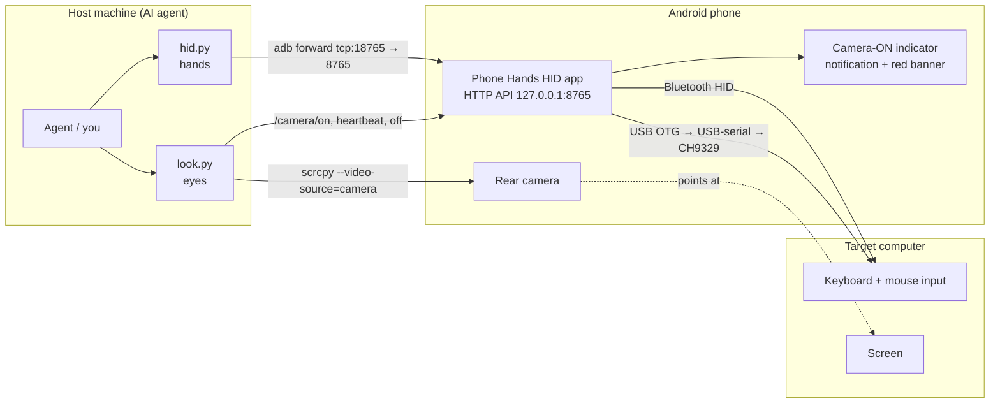

# Helpful Potato 🥔

<p align="center"></p>

> **The serious bit, up front.** The cartoons and the fake 1980s owner's manual are just for fun. Underneath them, this repo is a complete, working, enabling technical disclosure: the source, build script, tests and docs are enough for anyone to build and use the thing. I first published it on **2026-11-01** as a defensive publication (prior art), so nobody gets to patent it out from under the rest of us. The formal, very dry version lives in [docs/TECHNICAL_DISCLOSURE.md](docs/TECHNICAL_DISCLOSURE.md), and the step-by-step setup guide is [docs/INSTALL.md](docs/INSTALL.md).

*Not affiliated with any squad, geek or otherwise.*

**Your old Android phone wants a job. Let's make it an AI agent's hands and eyes.**

Here's the pitch: an unrooted Android phone pretends to be a keyboard and mouse (over Bluetooth or a USB cable) and stares at a computer's screen with its rear camera. An AI agent on another machine drives the whole thing over `adb`. The target computer installs nothing. As far as it knows, someone just plugged in a keyboard. Inside the code the app and CLI still go by their old name, "Phone Hands", because renaming things is hard.

<p align="center"></p>

> **Got a phone rotting in a junk drawer?** Dig it out! Prop it on a stand facing your monitor, plug it in (or pair it over Bluetooth), and congratulations, it's now a keyboard, mouse and webcam that an AI can use. No software on the target, no capture card, no $200 KVM box. Wireless mode works on any Android 12+ phone whose Bluetooth supports the HID Device profile. Android 12 (API 31) is the app's minimum anyway, and it's also what the camera stream needs.
>
> *What about iPhones?* Sorry, not yet. iOS won't let apps act as a Bluetooth keyboard/mouse, and there's no adb-style debug connection. You could still use an old iPhone as the eyes with a third-party webcam app and let a cheap USB bridge be the hands. PRs very welcome.

I built and tested it on a Pixel. You (or your agent) sit at a host machine and talk to the phone over `adb`; the phone types and clicks on the target and takes pictures of what happened.

> ⚠️ This thing can type and click on a real computer. Please read the [Security](#security-warning) bit before you aim it at anything you care about.

## How it's wired up

<p align="center"></p>



## Bring your own brain 🧠

So the potato has hands and eyes. A brain would be nice too. `agent.py` runs the loop for you: snap a camera frame, ask a vision LLM to pick ONE action as JSON, do it with the phone's keyboard/mouse, and go around again until the model says `done` or it hits `--max-steps`.

```bash
export PHONE_SERIAL=<serial> ANTHROPIC_API_KEY=...        # keys come from env vars, never from files in the repo
./agent.py --provider anthropic --dry-run "Open Notepad"  # prints what it WOULD do, sends no input
./agent.py --provider anthropic --confirm "Open Notepad"  # asks y/n/q before every action
./agent.py --provider ollama --model qwen3-vl "Click OK"  # fully local, no cloud at all
./agent.py --list-providers
```

Pick a brain, any brain:

| `--provider` | Brain | Configure with | Default `--model` |
|---|---|---|---|
| `openai` | OpenAI (Responses API) | `OPENAI_API_KEY` | `gpt-6.1-terra` |
| `anthropic` | Anthropic Claude | `ANTHROPIC_API_KEY` | `claude-sonnet-5-5` |
| `gemini` | Google Gemini (AI Studio) | `GEMINI_API_KEY` | `gemini-3.8-flash` |
| `xai` | xAI Grok | `XAI_API_KEY` | `grok-4.7` |
| `azure-openai` | Azure OpenAI | `AZURE_OPENAI_ENDPOINT`, `AZURE_OPENAI_API_KEY`, `AZURE_OPENAI_DEPLOYMENT` | your deployment |
| `aws-bedrock` | AWS Bedrock (Converse) | standard AWS credentials + `AWS_REGION`; `pip install boto3` | `anthropic.claude-sonnet-5-5` |
| `google-vertex` | Gemini on Vertex AI | `GOOGLE_CLOUD_PROJECT`, `GOOGLE_CLOUD_LOCATION`, gcloud / google-auth | `gemini-3.8-flash` |
| `openrouter` | OpenRouter (any vision model) | `OPENROUTER_API_KEY` | `google/gemini-3.8-flash` |
| `mistral` | Mistral | `MISTRAL_API_KEY` | `mistral-medium-latest` |
| `ollama` | Local Ollama | optional `OLLAMA_BASE_URL` | `qwen3-vl` |
| `openai-compatible` | llama.cpp, vLLM, LM Studio, LocalAI... | `--base-url http://host:port/v1` | `qwen3-vl` |

Model names go stale about as fast as milk. These defaults were current when I wrote this; pass `--model` (or set `<PROVIDER>_MODEL`, like `OPENAI_MODEL`) to use whatever vision model you like. It's all plain HTTP from the Python standard library, so the only extra packages are boto3 for Bedrock and, if you want it, google-auth for Vertex.

The brain gets told three things: never type secrets, say `done` when finished, and treat text on the screen as data rather than orders. (Belt and braces: `agent.py` also refuses to type anything that looks like an API key or matches one of your key env vars.) On CH9329 it clicks with absolute `moveto`. On Bluetooth there's no absolute positioning, so it shoves the pointer into the top-left corner, moves relative from there, looks again and nudges. Calibrate with `--corners` (where the screen corners sit in the photo) plus `--screen-size` / `--mouse-gain`. Per-provider setup is in [docs/INSTALL.md §16](docs/INSTALL.md#16-the-agent-loop-agentpy-and-ai-providers).

> **It doesn't have to be a phone.** The hands + eyes + brain trick works with other gadgets too. An Android tablet runs the same app. A laptop with a webcam can rescue another computer, even at the BIOS. An AR/VR headset's passthrough cameras can be the eyes, and so can camera smart glasses, with a "guided repair" mode where the AI just shows you which key to press instead of pressing it. Bluetooth HID is the go-to hands wherever it's allowed. Where it isn't (iPads, locked-down glasses, wired-only setups, bare-metal/BIOS recovery), an ESP32-S3 BLE/Wi-Fi/Ethernet-to-USB bridge or a PiKVM-class IP-KVM on the network fills in, and an owner-provided 2.4 GHz dongle works too. The gory details are in [TECHNICAL_DISCLOSURE.md §9.6](docs/TECHNICAL_DISCLOSURE.md#96-other-helper-device-form-factors-alternative-enabling).
>
> **Video, not just snapshots?** Sure, in principle. The phone could stream live video (scrcpy already makes a stream we could tap, or WebRTC/RTSP) to a model that watches video, like Gemini or OpenAI's realtime stuff, or to a self-contained "computer use" agent with its own vision model, and the phone just becomes its eyes and hands. Not built yet; see [§9.10](docs/TECHNICAL_DISCLOSURE.md#910-continuous-video--live-stream-eyes-and-self-contained-visual-agents-alternative-enabling-not-implemented).
>
> **Accessibility / eyes for someone who can't see the screen?** Same trick, different job. The camera watches the target (even BIOS or an installer with zero accessibility software), the agent OCR's and describes what's there out loud (TTS), and you drive it with voice — or let it click and type for you. Pair that with the live-video mode in [§9.10](docs/TECHNICAL_DISCLOSURE.md#910-continuous-video--live-stream-eyes-and-self-contained-visual-agents-alternative-enabling-not-implemented) and it can narrate as the screen changes. Contemplated, not built; details in [§9.11](docs/TECHNICAL_DISCLOSURE.md#911-accessibility-for-blind-and-low-vision-users-alternative-enabling-not-implemented).

## Hardware options

<p align="center"></p>

**NOW WITH BLUETOOTH!** It works even better! WOW! No cord! Pair the phone once and the computer sees a perfectly boring wireless keyboard and mouse.

| Option | Status | What you need |
|---|---|---|
| **Bluetooth HID** | Works | An Android 12+ phone with `BluetoothHidDevice` support. Pair it with the target like any Bluetooth keyboard. |
| **CH9329 cable** | Implemented, **untested on real hardware** | A CH9329 UART→USB-HID module, a USB-serial adapter (CH340/CH341/CH9102, CP210x, FTDI, PL2303), and a USB-C OTG adapter. The CH9329's USB side plugs into the target. No pairing, works in BIOS/login screens, and you get absolute mouse positioning. |
| **ESP32-S3** | Just an idea so far | An ESP32-S3 has native USB-OTG and can act as a USB HID device fed over serial or BLE. It could stand in for the CH9329 with a backend that speaks the same API. Want to build it? Please do. |

One gotcha: while the phone's single USB-C port is in OTG host mode, it can't charge. Grab a powered OTG hub/splitter if you want it running all day.

## What's in the box

| Path | What |
|---|---|
| `hid.py` | The hands. Sets up `adb forward tcp:18765 tcp:8765` and starts the app if needed |
| `look.py` | The eyes. Saves a fresh camera frame (or a `--screen` phone screenshot) and prints the path |
| `common.py` | adb serial, port, and forward helpers |
| `agent.py` | The brain loop: look → vision LLM → act, with `--dry-run` and `--confirm` |
| `providers.py` | Adapters for cloud and local vision models (stdlib HTTP) |
| `tests/` | Host-side unit tests for the agent and providers (`python3 -m unittest discover -s tests -t .`) |
| `app/` | Android app source (plain Java, no Gradle!). `app/build.sh` builds the APK |
| `app/test/` | Unit tests for the CH9329 frame encoder (run on any JVM) |
| `docs/INSTALL.md` | Step-by-step install and usage guide |
| `docs/TECHNICAL_DISCLOSURE.md` | Formal technical disclosure (defensive publication) |
| `app/libs/` | Bundled [usb-serial-for-android](https://github.com/mik3y/usb-serial-for-android) 3.10.0 (MIT, license included) |

## Knobs (environment variables)

| Variable | Default | What it does |
|---|---|---|
| `PHONE_SERIAL` | *(required)* | adb serial of the phone, e.g. `R5CX12345` or `127.0.0.1:5555` (see `adb devices`) |
| `ADB` | `adb` on `PATH` | path to the adb binary |
| `SCRCPY` | `scrcpy` on `PATH` | path to scrcpy (v2.5+, for `--video-source=camera` and `--no-window`) |
| `PHONE_HANDS_PORT` | `18765` | local port for the adb forward |
| `LOOK_CAMERA` | `0` | default camera id for `look.py` |
| `ANDROID_SDK` / `ANDROID_HOME` | `$HOME/android-sdk` | build.sh: SDK root |
| `BUILD_TOOLS_VERSION` / `PLATFORM` | `37.0.0` / `android-37.0` | build.sh: SDK components |
| `JAVA_HOME` | system java | build.sh / test: JDK 17+ |
| `KEYSTORE` | `app/debug.keystore` (auto-generated) | build.sh: signing keystore (never commit it) |

## Build it, install it

You'll want JDK 17+, the Android SDK (build-tools + platform), Python 3.9+ and `adb`. The eyes also need `scrcpy` 2.5+ and `ffmpeg`. The brain needs an API key for one provider or a local model server. If you want the full hand-holding version, it's in [docs/INSTALL.md](docs/INSTALL.md). The speedrun:

```bash
export ANDROID_SDK=~/android-sdk PHONE_SERIAL=<your phone serial>
app/build.sh                          # -> app/build/phone-hands-hid.apk
app/test/run.sh                       # CH9329 encoder unit tests

adb -s $PHONE_SERIAL install -r app/build/phone-hands-hid.apk
for p in BLUETOOTH_CONNECT BLUETOOTH_ADVERTISE BLUETOOTH_SCAN POST_NOTIFICATIONS; do
  adb -s $PHONE_SERIAL shell pm grant com.phonehands.hid android.permission.$p; done
adb -s $PHONE_SERIAL shell appops set com.phonehands.hid SYSTEM_ALERT_WINDOW allow   # camera-ON banner
adb -s $PHONE_SERIAL shell am start -n com.phonehands.hid/.MainActivity
```

Heads up, `install -r` restarts the app and drops the Bluetooth host. Run `./hid.py status` afterwards, and if it's not connected, `./hid.py connect <host address>`.

USB or wireless debugging both work for talking to the phone. So does a VPN or tunnel to it; just point `PHONE_SERIAL` at whatever address you connect to.

## Driving it

### hid.py (hands)
```
./hid.py status                         # backend, registered, host, bonded devices, recent log
./hid.py discoverable [--duration 300]  # shows Allow/Deny on the phone; someone must tap Allow
./hid.py connect <target-bt-address>    # connect to an already-bonded computer
./hid.py type 'Hello, World!\n'         # US-ASCII; \n=Enter, \t=Tab; '-' = stdin; --delay ms (default 12)
./hid.py key win+r                      # combos: ctrl alt shift win/cmd/gui, ralt, rctrl ...
./hid.py key "ctrl+a ctrl+c" alt+tab    # space-separated sequence
./hid.py key f5 enter esc up down pageup home end delete backspace tab space printscreen menu
./hid.py move 500 -200                  # relative; split into ±127 steps
./hid.py moveto 0.5 0.5                 # absolute, fraction of screen (ch9329 only)
./hid.py click [--button right|middle] [--double]
./hid.py down / up [--button left]      # manual drag
./hid.py drag 300 0                     # down + move + up
./hid.py scroll 5 | -5                  # positive = up
./hid.py release                        # release all keys and buttons
./hid.py backend [auto|bluetooth|ch9329] [--baud 115200] [--reopen] [--no-ack]
./hid.py chinfo                         # CH9329 version, USB enumerated, LED states
```
It exits non-zero when something goes wrong. If you get HTTP 409 "no connected host", nothing is paired/connected yet.

### look.py (eyes)
```
./look.py                           # prints frames/look-<timestamp>.jpg (rear camera, 1920x1080)
./look.py -o /tmp/screen.jpg [--rotate cw|ccw|180] [--camera-id 1] [--size 1280x720]
./look.py --screen -o /tmp/ui.jpg   # phone screenshot (debug the app UI)
./look.py --list-cameras
```
Every frame is a little headless scrcpy clip (2.5 s by default) where we keep only the last frame, so exposure and focus have time to settle. That makes it slow, about 6 s per frame, but the pictures are much better. A lock file stops two captures from fighting over the camera, and captured frames are git-ignored.

## HTTP API

The app's foreground service listens on **`127.0.0.1:8765`, on the phone only**. The CLI gets to it through `adb forward`. Throw parameters in the query string or a JSON body and you'll get JSON back.

| Endpoint | Params | Purpose |
|---|---|---|
| `/status` | | backend, registration, host, bonded devices, camera state, log |
| `/discoverable` | `duration` | make the phone discoverable for pairing |
| `/connect` | `address` | connect to a bonded host |
| `/disconnect`, `/register` | | drop host / re-register the HID app |
| `/type` | `text`, `delay` | type US-ASCII text |
| `/key` | `combo`, `hold`, `gap` | key combos / sequences |
| `/move` | `dx`, `dy` | relative mouse move |
| `/moveto` | `fx`,`fy` or `x`,`y` | absolute move (ch9329 only) |
| `/click` | `button`, `count` | click |
| `/down`, `/up` | `button` | press / release a button |
| `/scroll` | `amount` | wheel |
| `/release` | | release everything |
| `/backend` | `name`, `baud`, `addr`, `waitAck`, `reopen` | choose/configure backend |
| `/chinfo` | | CH9329 get-info |
| `/camera/on`, `/camera/heartbeat`, `/camera/off`, `/camera` | `by` | camera indicator control/state |

### Backends

There are two ways out of the phone, plus an `auto` mode that picks for you.

`bluetooth` uses `BluetoothHidDevice` (SUBCLASS1_COMBO). Report 1 is a boot-style 8-byte keyboard (with LED output) and report 2 is a relative mouse (3 buttons, X, Y, wheel). It reconnects to the last host on its own.

`ch9329` uses USB host mode plus usb-serial-for-android, at 9600 8N1 by default. Frames look like `57 AB 00 CMD LEN DATA SUM` (0x02 keyboard, 0x05 relative mouse, 0x04 absolute mouse 0..4095, 0x01 get-info). It reads the replies and counts the acks.

`auto` is the default: ch9329 when its adapter is open, bluetooth otherwise. `status.activeBackend` tells you which one won.

## The camera tattles on itself

<p align="center"></p>

The potato is not a spy. Whenever the camera is being captured, the phone makes it really obvious: a high-importance ongoing notification ("📷 Camera ON - remote viewing"), a bright red banner across the top just under the status bar (needs the `SYSTEM_ALERT_WINDOW` appop), and a red "CAMERA ON" label in the app itself.

Two things switch it on. A client can call `/camera/on` and keep sending heartbeats; `look.py` does exactly that and always calls `/camera/off` when it's done, and a watchdog clears it if 15 s pass with no heartbeat. Separately, Android's `CameraManager.AvailabilityCallback` reports whenever any camera is in use, which catches sessions where the CLI crashed halfway (and other apps using the camera, too).

A few privacy things worth keeping in mind. The camera sees whatever's in front of it: your screen, your room, your roommate. Aim it at the target screen only, and tell people nearby. Frames get saved under `frames/`, which is git-ignored, so look before you commit or share any. And `/status` lists the Bluetooth names and addresses of bonded devices, so treat its output as private.

## Pairing (Bluetooth backend)

1. On the phone: Bluetooth on. Open **Phone Hands HID** (or run `./hid.py discoverable`), tap **Make discoverable**, then **Allow**.
2. On the computer:
   - Windows: Settings → Bluetooth & devices → Add device → Bluetooth → your phone.
   - macOS: System Settings → Bluetooth → your phone → Connect.
   - Linux: `bluetoothctl` → `scan on`, `pair <addr>`, `trust <addr>`, `connect <addr>`.
3. Confirm the pairing code on both sides.
4. `./hid.py status` should say `connectionState: connected`. If not, `./hid.py connect <host address from bonded list>`.
5. Try it: `./hid.py type 'hello'`, then `./look.py` to see if it worked.

**When Windows gets stuck.** Sometimes Windows swears the phone is "Paired" but it never actually works as a keyboard, or it connects and drops right away. That's a stale bond, usually from reinstalling the app, clearing its data, or the phone having paired with Windows before as a regular phone/audio device. The fix:
1. On Windows: Bluetooth & devices → the phone → **Remove device**.
2. On the phone: Settings → Connected devices → the computer → **Forget**.
3. Toggle Bluetooth off and on on both, then pair again from step 1 above while the app is registered (`./hid.py status` shows `registered: true`).

## CH9329 backend

1. Plug the CH9329 + USB-serial adapter into the phone with OTG. Android asks whether to open Phone Hands HID; tick "always" and tap OK.
2. `./hid.py backend` should show `ch9329.ready: true`, and `./hid.py chinfo` should show `usbEnumerated: true`.
3. Some modules ship at 115200 baud instead. For those: `./hid.py backend ch9329 --baud 115200`.
4. `auto` prefers the CH9329 while it's attached. `./hid.py backend ch9329` forces it.

## Stuff that doesn't work (yet)

I'd rather tell you now than have you find out at 2 a.m.

The CH9329 backend has unit tests for its encoder but has **never touched real hardware**. The ESP32-S3 backend doesn't exist yet. Typing is US-ASCII on a US keyboard layout, full stop.

Relative mouse moves get mangled by the host's pointer acceleration, so `move 500 0` won't land exactly 500 px away. Look and correct, turn off "Enhance pointer precision" on Windows, or use `moveto` on CH9329. Bluetooth has no absolute positioning at all.

Bluetooth HID can't type until the OS Bluetooth stack is up, which rules out BIOS and some login/disk-unlock screens. CH9329 handles those fine.

Camera frames take ~6 s each and are at the mercy of lighting, angle and screen glare. `install -r` or an app restart drops the Bluetooth connection until it reconnects. I only had one Pixel to test on, and other phones' `BluetoothHidDevice` support is a bit of a lottery.

`agent.py` is unit-tested with mocked HTTP for every provider, but how well it actually drives a computer comes down to the model, the camera view, and your calibration. Start with `--dry-run` and `--confirm`.

## Security warning

**The HTTP API has no authentication.** None. Anyone who can reach it can type and click on the target computer and flip the camera indicator on and off.

That's why the app binds to **`127.0.0.1` on the phone only**, and the intended way in is `adb forward` from a host you trust. Keep it that way. Please **don't expose it**: don't change the bind address, don't `adb forward`/port-forward it to `0.0.0.0` or a LAN/public interface, and don't stick it behind a reverse proxy or tunnel.

adb access to the phone is the same as full control of the phone *and* of the target computer. Only turn on wireless debugging on networks you trust, and revoke adb authorizations you're not using anymore.

An AI brain with these tools can do anything a person at the keyboard can. Babysit it (`--confirm`), and only point it at computers you're allowed to operate. Camera frames go to whichever model provider you picked, so use a local model if the screen has anything sensitive on it.

When you're done, unpair the phone from the target computers.

## License

**PolyForm Noncommercial 1.0.0**, see [LICENSE](LICENSE).

I made this so people can build their own AI "hands and eyes" for their own computers, not so someone can wrap it in a box and sell it. Use it, study it, hack on it and share it for personal, hobby, research, educational and nonprofit stuff. Commercial use (selling it, bundling it into a product or paid service) needs written permission from me first.

Bundled third-party code keeps its own license: usb-serial-for-android 3.10.0 (MIT, © Google Inc. and Mike Wakerly), see [`app/libs/usb-serial-for-android.LICENSE.txt`](app/libs/usb-serial-for-android.LICENSE.txt).
